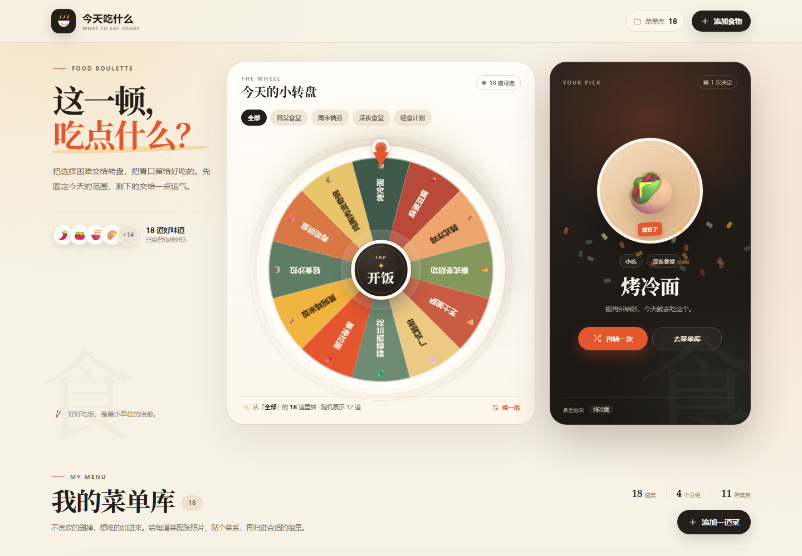
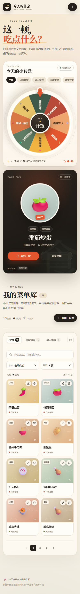

# 今天吃什么 · 幸运转盘

一个帮助你决定下一顿吃什么的中文网页。转动转盘，随机选一道菜；也可以维护自己的菜单、菜系和分组。

无需安装依赖或构建，下载后直接用浏览器打开 `index.html` 即可。

## 功能

- 幸运转盘随机选菜，支持按分组选择候选菜单、换一批菜品。
- 内置 18 道示例菜品和 4 个分组。
- 添加、编辑和删除菜品，自定义名称、菜系、分组、表情和图片。
- 支持上传本地图片、拖入图片或填写图片链接。
- 搜索、菜系筛选、分组筛选和分页浏览。
- 分组新增、重命名和删除。
- 自动将菜品和分组保存在当前浏览器的本地存储中。
- 适配桌面和手机屏幕。

## 预览

### 桌面



### 手机



## 本地使用

1. 下载仓库 ZIP 并解压，或克隆仓库。
2. 用现代浏览器打开 `index.html`。
3. 点击转盘开始选菜，或通过菜单管理添加自己的菜品。

如果电脑已安装 Python，也可以在项目目录运行：

```bash
python -m http.server 8000
```

然后访问 <http://localhost:8000>。使用固定地址访问更便于保持浏览器本地数据。

## 数据保存

本项目没有后端、账户或云端同步。菜单和分组保存在当前浏览器的 `localStorage` 中；切换浏览器、网址或清除站点数据后，原有菜单可能无法读取。转盘结果和最近抽选记录只在当前页面会话中保留。

默认页面无需联网加载脚本或图片。自行填写的远程图片链接需要联网；上传的本地图片会在浏览器中压缩后保存，仍受浏览器存储空间限制。

## 项目结构

```text
what-to-eat/
├── index.html              # 页面、样式、Vue 和应用逻辑
├── docs/images/
│   ├── desktop.png         # 原始桌面预览
│   └── mobile.png          # 原始手机预览
├── THIRD_PARTY_NOTICES.md  # 第三方依赖及许可证
├── .gitattributes
├── .gitignore
└── README.md
```

## 技术与部署

使用 HTML、CSS、JavaScript、Canvas 和内置 Vue 3.3.11，不需要 npm 或打包工具。可以部署到支持静态网页的托管服务。

如需使用 GitHub Pages，可在仓库 **Settings → Pages** 中选择 **Deploy from a branch**，将分支设为 `main`、目录设为 `/ (root)` 后保存。

## 第三方依赖

内置 Vue 的版权和 MIT 许可证见 [THIRD_PARTY_NOTICES.md](THIRD_PARTY_NOTICES.md)。此声明仅适用于所列第三方依赖。
